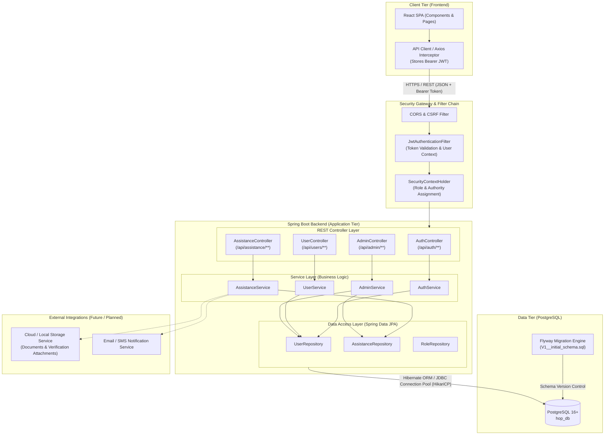

# HOP Project - Technical Architecture Documentation

**Version:** 1.0.0  
**Last Updated:** 2026-11-19  
**Status:** Baseline Architectural Blueprint  

---

## 1. System Architecture Overview

The HOP platform is architected as a decoupled, multi-tier enterprise web application comprising a client-side Single-Page Application (SPA), a stateless RESTful Spring Boot backend, and a PostgreSQL relational database managed through versioned migrations.

---

## 2. Component Interaction Architecture

The following diagram illustrates the interaction between system components, security filters, and data persistence layers:

---

## 3. Layer Responsibilities & Design Patterns

### 3.1 Client Layer (`frontend/`)
- **Technology:** React (TypeScript), Vite, React Router, Context API.
- **Role:** Delivers responsive UI for users, administrators, and donors.
- **Communication:** Pure asynchronous REST calls over HTTPS exchanging JSON payloads with `Authorization: Bearer <token>` headers.

### 3.2 Security Gateway & Filter Chain (`backend/com.hop.security`)
- **Spring Security 6+:** Configured for stateless session management (`SessionCreationPolicy.STATELESS`).
- **JWT Provider:** Validates incoming HMAC/RSA-signed tokens, extracts claims (username, user ID, granted authorities), and populates `SecurityContext`.
- **Method Security:** `@PreAuthorize("hasRole('ADMIN')")` protects restricted business methods.

### 3.3 Controller Layer (`backend/com.hop.*.controller`)
- **Role:** Handles HTTP request mapping, input validation via `@Valid`, and delegates immediately to service components.
- **Response Wrapper:** Uniform envelope pattern `ApiResponse<T>` with timestamp, status code, success flag, data payload, and error details.

### 3.4 Service Layer (`backend/com.hop.*.service`)
- **Role:** Encapsulates business logic, transactional boundaries (`@Transactional`), domain validation, and orchestration between repositories.

### 3.5 Data Access Layer (`backend/com.hop.*.repository`)
- **Technology:** Spring Data JPA with Hibernate provider.
- **Patterns:** Declarative repository interfaces extending `JpaRepository`, custom JPQL / specification queries where dynamic filtering is required.

### 3.6 Data Tier (`database/`)
- **Engine:** PostgreSQL.
- **Migration Strategy:** Version-controlled Flyway migrations stored under `database/migrations/`.
- **Connection Pool:** HikariCP managed by Spring Boot.

---

## 4. Current Implementation vs Planned Architecture Status

| Component | Architecture Design | Current Repository Status |
| :--- | :--- | :--- |
| **Frontend Framework** | React + TypeScript + Vite | **Scaffolded (Directories only)**; initialization pending Phase 12 |
| **Backend Framework** | Java 21 + Spring Boot 3.x | **Initialized** (`HopBackendApplication.java`, basic dependencies present) |
| **Security Layer** | JWT Stateless Filter Chain | **Scaffolded package**; implementation pending Phase 06 |
| **Domain Modules** | `auth`, `user`, `assistance`, `admin` | **Scaffolded packages**; entity & service creation pending Phases 06-10 |
| **Database Engine** | PostgreSQL (`hop_db`) | **Driver & config present**; migrations and validation pending Phase 04 |
| **Migration Tool** | Flyway | **Folder created (`database/migrations`)**; dependency integration pending |
