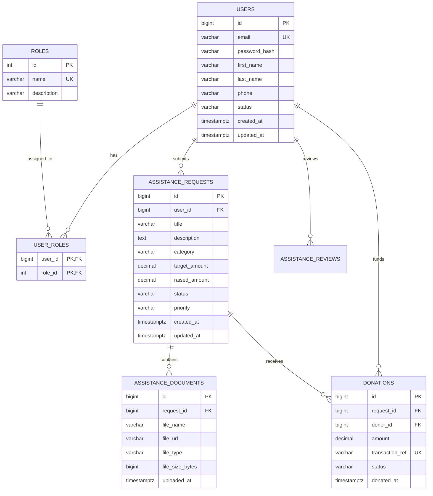

# HOP Project - Database Architecture & Schema Design

**Version:** 1.0.0  
**Last Updated:** 2026-11-19  
**Database Engine:** PostgreSQL 16+  
**Target Database Name:** `hop_db`  
**Migration Framework:** Flyway  

---

## 1. Overview & Migration Philosophy

The HOP database schema follows strict relational modeling principles:
- **Primary Keys:** UUID or auto-incrementing BigInt (64-bit integer) with uniform naming (`id`).
- **Audit Columns:** Every core table includes `created_at` (timestamp with time zone) and `updated_at`.
- **Soft Deletes:** Where necessary for audit compliance, `is_deleted` and `deleted_at` are provided.
- **Foreign Keys:** Explicit foreign key constraints with indexed lookup columns.
- **Migration Strategy:** Version-controlled Flyway migrations (`V1__initial_schema.sql`, `V2__...sql`) stored in `database/migrations/`.

> **Security Note:** Passwords, API keys, and connection credentials must never be committed to documentation or version control. Connection strings must reference environment variables.

---

## 2. Entity-Relationship Model (ERD)

---

## 3. Table Definitions & Specifications

### 3.1 Table: `users`
Stores user profile, authentication credentials, and account status.

| Column | Data Type | Constraints | Description |
|---|---|---|---|
| `id` | `BIGSERIAL` | `PRIMARY KEY` | Unique identifier for user |
| `email` | `VARCHAR(255)` | `NOT NULL, UNIQUE` | User login email address |
| `password_hash` | `VARCHAR(255)` | `NOT NULL` | BCrypt/Argon2 encrypted password |
| `first_name` | `VARCHAR(100)` | `NOT NULL` | User given name |
| `last_name` | `VARCHAR(100)` | `NOT NULL` | User family name |
| `phone` | `VARCHAR(20)` | `NULL` | Optional contact telephone number |
| `status` | `VARCHAR(30)` | `NOT NULL, DEFAULT 'ACTIVE'` | `ACTIVE`, `PENDING`, `SUSPENDED` |
| `created_at` | `TIMESTAMPTZ` | `NOT NULL, DEFAULT NOW()` | Account creation timestamp |
| `updated_at` | `TIMESTAMPTZ` | `NOT NULL, DEFAULT NOW()` | Last update timestamp |

**Indexes:**
- `idx_users_email` ON `users(email)`
- `idx_users_status` ON `users(status)`

---

### 3.2 Table: `roles`
Stores application roles for role-based access control (RBAC).

| Column | Data Type | Constraints | Description |
|---|---|---|---|
| `id` | `SERIAL` | `PRIMARY KEY` | Role identifier |
| `name` | `VARCHAR(50)` | `NOT NULL, UNIQUE` | `ROLE_USER`, `ROLE_ADMIN`, `ROLE_DONOR`, `ROLE_ASSISTANT` |
| `description` | `VARCHAR(255)` | `NULL` | Description of role permissions |

---

### 3.3 Table: `user_roles`
Join table establishing many-to-many relationship between users and roles.

| Column | Data Type | Constraints | Description |
|---|---|---|---|
| `user_id` | `BIGINT` | `NOT NULL, FK -> users(id) ON DELETE CASCADE` | Reference to user |
| `role_id` | `INT` | `NOT NULL, FK -> roles(id) ON DELETE CASCADE` | Reference to role |

**Primary Key:** `(user_id, role_id)`

---

### 3.4 Table: `assistance_requests`
Stores assistance requests submitted by users.

| Column | Data Type | Constraints | Description |
|---|---|---|---|
| `id` | `BIGSERIAL` | `PRIMARY KEY` | Unique request identifier |
| `user_id` | `BIGINT` | `NOT NULL, FK -> users(id)` | Applicant user identifier |
| `title` | `VARCHAR(200)` | `NOT NULL` | Concise request title |
| `description` | `TEXT` | `NOT NULL` | Detailed statement of need |
| `category` | `VARCHAR(50)` | `NOT NULL` | E.g., `MEDICAL`, `EDUCATION`, `EMERGENCY` |
| `target_amount` | `NUMERIC(12, 2)` | `NOT NULL, CHECK (target_amount >= 0)` | Financial assistance requested |
| `raised_amount` | `NUMERIC(12, 2)` | `NOT NULL, DEFAULT 0.00` | Total contributions allocated |
| `status` | `VARCHAR(30)` | `NOT NULL, DEFAULT 'PENDING'` | `PENDING`, `UNDER_REVIEW`, `APPROVED`, `REJECTED`, `FULFILLED` |
| `priority` | `VARCHAR(20)` | `NOT NULL, DEFAULT 'MEDIUM'` | `LOW`, `MEDIUM`, `HIGH`, `URGENT` |
| `created_at` | `TIMESTAMPTZ` | `NOT NULL, DEFAULT NOW()` | Submission timestamp |
| `updated_at` | `TIMESTAMPTZ` | `NOT NULL, DEFAULT NOW()` | Modification timestamp |

**Indexes:**
- `idx_assistance_user_id` ON `assistance_requests(user_id)`
- `idx_assistance_status` ON `assistance_requests(status)`
- `idx_assistance_category` ON `assistance_requests(category)`

---

### 3.5 Table: `assistance_documents`
Stores metadata and file locations for documentation supporting assistance requests.

| Column | Data Type | Constraints | Description |
|---|---|---|---|
| `id` | `BIGSERIAL` | `PRIMARY KEY` | Document identifier |
| `request_id` | `BIGINT` | `NOT NULL, FK -> assistance_requests(id) ON DELETE CASCADE` | Associated request |
| `file_name` | `VARCHAR(255)` | `NOT NULL` | Original uploaded filename |
| `file_url` | `VARCHAR(500)` | `NOT NULL` | Secure file path or cloud URI |
| `file_type` | `VARCHAR(100)` | `NOT NULL` | MIME type (e.g., `application/pdf`) |
| `file_size_bytes` | `BIGINT` | `NOT NULL` | File size in bytes |
| `uploaded_at` | `TIMESTAMPTZ` | `NOT NULL, DEFAULT NOW()` | Upload timestamp |

---

### 3.6 Table: `donations`
Maintains donation records connecting donors with approved assistance requests.

| Column | Data Type | Constraints | Description |
|---|---|---|---|
| `id` | `BIGSERIAL` | `PRIMARY KEY` | Donation identifier |
| `request_id` | `BIGINT` | `NOT NULL, FK -> assistance_requests(id)` | Assistance request funded |
| `donor_id` | `BIGINT` | `NOT NULL, FK -> users(id)` | Donor user account |
| `amount` | `NUMERIC(12, 2)` | `NOT NULL, CHECK (amount > 0)` | Contribution amount |
| `transaction_ref` | `VARCHAR(100)` | `NOT NULL, UNIQUE` | Payment gateway transaction reference |
| `status` | `VARCHAR(30)` | `NOT NULL, DEFAULT 'COMPLETED'` | `PENDING`, `COMPLETED`, `FAILED`, `REFUNDED` |
| `donated_at` | `TIMESTAMPTZ` | `NOT NULL, DEFAULT NOW()` | Payment timestamp |

---

## 4. Entity-to-Table Mapping (Spring Data JPA)

| Java Entity | Package Path | PostgreSQL Table | Primary Key |
|---|---|---|---|
| `User` | `com.hop.user.entity.User` | `users` | `Long id` |
| `Role` | `com.hop.user.entity.Role` | `roles` | `Integer id` |
| `AssistanceRequest` | `com.hop.assistance.entity.AssistanceRequest` | `assistance_requests` | `Long id` |
| `AssistanceDocument`| `com.hop.assistance.entity.AssistanceDocument`| `assistance_documents` | `Long id` |
| `Donation` | `com.hop.donation.entity.Donation` | `donations` | `Long id` |

---

## 5. Current Implementation vs Planned Status

- **Database Server:** Local PostgreSQL instance targeted at `localhost:5432/hop_db`.
- **Database Operations Executed:** **Zero.** Tables have not been created yet.
- **Next Migration Milestone:** Create `database/migrations/V1__initial_schema.sql` during Phase 04.
