# HOP Project - Complete Development Workflow & Progress Tracker

**Document Version:** 1.1.0  
**Last Updated:** 2026-11-19  
**Status Legend:**
- `[COMPLETED]` — Implementation finished, verified, tested, documented, and approved.
- `[IN PROGRESS]` — Currently active; work is underway.
- `[NEEDS REVIEW]` — Work is submitted or pending technical audit before progression.
- `[NOT STARTED]` — Scoped and queued for upcoming phases.
- `[BLOCKED]` — Impeded by external dependencies or unresolved blockers.

---

## 1. Visual Development Workflow Diagram

```mermaid
flowchart TD
    %% Workflow Steps
    S01["1. Project Audit<br/><b>[COMPLETED]</b>"] --> S02["2. Architecture Verification<br/><b>[COMPLETED]</b>"]
    S02 --> S03["3. Dependency Verification<br/><b>[COMPLETED]</b>"]
    S03 --> S04["4. Database Validation<br/><b>[COMPLETED]</b>"]
    S04 --> S05["5. Backend Foundation<br/><b>[COMPLETED]</b>"]
    S05 --> S06["6. Authentication & Authorization<br/><b>[COMPLETED]</b>"]
    S06 --> S07["7. User Management<br/><b>[COMPLETED]</b>"]
    S07 --> S08["8. Assistance Request Management<br/><b>[COMPLETED]</b>"]
    S08 --> S09["9. Document Management<br/><b>[COMPLETED]</b>"]
    S09 --> S10["10. Admin Management<br/><b>[COMPLETED]</b>"]
    S10 --> S11["11. Donor & Donation Management<br/><b>[COMPLETED]</b>"]
    S11 --> S12["12. Frontend Development<br/><b>[COMPLETED]</b>"]
    S12 --> S13["13. Backend-Frontend Integration<br/><b>[COMPLETED]</b>"]
    S13 --> S14["14. Complete Application Testing<br/><b>[COMPLETED]</b>"]
    S14 --> S15["15. Optimization<br/><b>[COMPLETED]</b>"]
    S15 --> S16["16. Final Documentation<br/><b>[IN PROGRESS]</b>"]
    S16 --> S17["17. Deployment Preparation<br/><b>[NOT STARTED]</b>"]

    %% Styling
    style S01 fill:#d4edda,stroke:#28a745,stroke-width:2px,color:#155724
    style S02 fill:#d4edda,stroke:#28a745,stroke-width:2px,color:#155724
    style S03 fill:#d4edda,stroke:#28a745,stroke-width:2px,color:#155724
    style S04 fill:#d4edda,stroke:#28a745,stroke-width:2px,color:#155724
    style S05 fill:#d4edda,stroke:#28a745,stroke-width:2px,color:#155724
    style S06 fill:#d4edda,stroke:#28a745,stroke-width:2px,color:#155724
    style S07 fill:#d4edda,stroke:#28a745,stroke-width:2px,color:#155724
    style S08 fill:#d4edda,stroke:#28a745,stroke-width:2px,color:#155724
    style S09 fill:#d4edda,stroke:#28a745,stroke-width:2px,color:#155724
    style S10 fill:#d4edda,stroke:#28a745,stroke-width:2px,color:#155724
    style S11 fill:#d4edda,stroke:#28a745,stroke-width:2px,color:#155724
    style S12 fill:#d4edda,stroke:#28a745,stroke-width:2px,color:#155724
    style S13 fill:#d4edda,stroke:#28a745,stroke-width:2px,color:#155724
    style S14 fill:#d4edda,stroke:#28a745,stroke-width:2px,color:#155724
    style S15 fill:#d4edda,stroke:#28a745,stroke-width:2px,color:#155724
    style S16 fill:#fff3cd,stroke:#ffc107,stroke-width:2px,color:#856404
    style S17 fill:#e2e3e5,stroke:#6c757d,stroke-width:1px,color:#383d41
```

---

## 2. Phase-by-Phase Status and Tracking

| # | Phase Name | Current Status | Description & Scope | Deliverables / Artifacts |
|---|---|---|---|---|
| **01** | **Project Audit** | `[COMPLETED]` | Initial workspace inspection, directory audit, gitignore setup, and initial root structure creation. | Root `.gitignore`, `README.md`, baseline audit logs |
| **02** | **Architecture Verification** | `[COMPLETED]` | Validation of folder topology across root, frontend, backend, database, and docs. Domain package alignment. | Clean directory structure, domain layout in backend, component layout in frontend |
| **03** | **Dependency Verification** | `[COMPLETED]` | Inspection and validation of Maven dependencies in `pom.xml`, addition of Flyway and H2 test drivers. | `backend/pom.xml`, clean compile & test assertions |
| **04** | **Database Validation** | `[COMPLETED]` | PostgreSQL schema model design, Flyway migration `V1__initial_schema.sql`, Hibernate `validate` mode. | `database/migrations/V1__initial_schema.sql`, test config |
| **05** | **Backend Foundation** | `[COMPLETED]` | Common response wrapper (`ApiResponse`), error handling (`GlobalExceptionHandler`), domain enums, CORS. | `common/response/`, `common/exception/`, `common/enums/`, `config/WebConfig.java` |
| **06** | **Authentication & Authorization** | `[COMPLETED]` | Spring Security filter chain, stateless JWT authentication, password encryption, login and registration flows. | `security/`, `auth/controller/`, `auth/service/`, JWT providers |
| **07** | **User Management** | `[COMPLETED]` | User entities, profile management, role assignment (USER, ADMIN, DONOR, ASSISTANT), profile update services. | `user/entity/`, `user/controller/`, `user/service/`, `user/repository/` |
| **08** | **Assistance Request Management** | `[COMPLETED]` | Assistance request domain, status workflows (PENDING, APPROVED, REJECTED, FULFILLED), priority assignment. | `assistance/entity/`, `assistance/service/`, `assistance/controller/` |
| **09** | **Document Management** | `[COMPLETED]` | Verification documents, attachment handling, secure file metadata storage and access controls. | `document/` domain package, upload handlers, storage service |
| **10** | **Admin Management** | `[COMPLETED]` | Administrative oversight, user auditing, request review dashboards, moderation endpoints, system reporting. | `admin/controller/`, `admin/service/`, audit logging |
| **11** | **Donor & Donation Management** | `[COMPLETED]` | Donation tracking, donor profiles, funding allocation to approved assistance requests, financial audit trails. | `donation/` domain package, payment records, transaction tracking |
| **12** | **Frontend Development** | `[COMPLETED]` | React client initialization, design system, route definitions, layout shells, context providers, custom hooks. | React Vite app in `frontend/`, UI components, pages |
| **13** | **Backend-Frontend Integration** | `[COMPLETED]` | REST API client implementation, Axios interceptors, JWT storage, CORS handling, end-to-end data flow. | `frontend/src/services/api.ts`, auth interceptors, data hooks |
| **14** | **Complete Application Testing** | `[COMPLETED]` | Unit tests, integration tests, Spring MockMvc tests, frontend component tests, end-to-end user journey tests. | Backend tests in `src/test/`, frontend test suites, test reports |
| **15** | **Optimization** | `[COMPLETED]` | Database indexing, query optimization, caching strategies, bundle size optimization, security audit. | Index migrations, cache config, production build metrics |
| **16** | **Final Documentation** | `[IN PROGRESS]` | Continuous documentation framework, phase reports, architecture diagrams, API specs, database docs, master PDF. | `docs/project-documentation/`, `HOP_Project_Master_Documentation.pdf` |
| **17** | **Deployment Preparation** | `[NOT STARTED]` | Docker containerization, production environment configuration, CI/CD pipeline definitions, health probes. | `Dockerfile`, `docker-compose.yml`, deployment runbooks |
